[](https://artifacthub.io/packages/container/amyos/amyos)

<div align="center">
  <picture>
    <source media="(prefers-color-scheme: light)" srcset="repo_files/amy-logo-black.png">
    
  </picture>
</div>

# Amy OS

A minimal KDE Plasma desktop with the Amy OS name and logo.

- **Debian testing:** live ISO with the Calamares installer, for AMD64 and ARM64.
- **Ubuntu 26.04 LTS:** live ISO with the Calamares installer, for AMD64 and ARM64.
- **Fedora:** bootc image, for AMD64 and ARM64.

## Debian

Download the ISO from [Releases](https://github.com/astrovm/amyos/releases),
write it to a USB stick and boot it.

The ARM64 ISO also boots on:

- **Raspberry Pi 3, 4 and 5:** from an SD card. Live session only.
- **Apple Silicon Macs:** through the Asahi installer's **UEFI environment only** option.

## Ubuntu

The same desktop and installer on Ubuntu 26.04 LTS. Download the ISO from
[Releases](https://github.com/astrovm/amyos/releases?q=ubuntu&expanded=true),
write it to a USB stick and boot it.

## Fedora

```bash
sudo bootc switch ghcr.io/astrovm/amyos:fedora
```

## Build

```bash
sudo just build         # Debian ISO, into output/
sudo just build-ubuntu  # Ubuntu ISO, into output/
just build-fedora       # Fedora image, as localhost/amyos:fedora
just run-vm             # Boot the newest ISO
```
